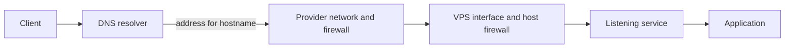

# 01 — Network paths, IP addresses, and ports

## Learning objectives

After this lesson, you can explain the path from a client to a VPS service, distinguish an address from a port and a protocol, and identify the network layers to check when a connection fails.

## The request path

A public application request usually passes through several independent controls:



DNS answers which address to contact; it does not route traffic or open a port. The VPS provider may apply a firewall before packets reach the machine. The host firewall is another control. Finally, a process must be listening on the destination address and port. A failure at any one layer can make a service unreachable.

## Addresses, interfaces, and routes

An IP address identifies a network interface within a network. IPv4 addresses have a familiar dotted form; IPv6 addresses use hexadecimal groups. A **public** address is globally routable, while **private** addresses are used inside networks and are not directly reachable from the public internet. Loopback addresses (`127.0.0.1` and `::1`) refer back to the same machine.

A VPS may have more than one interface or address, and a provider can place filtering or NAT in front of it. Do not assume the address shown inside the guest is the only externally relevant address. Compare the provider's control panel with read-only host observations:

```sh
ip -brief address
ip route
ip -6 route
ss -lntup
```

`ip address` shows addresses assigned to interfaces, `ip route` shows IPv4 route selection, and `ip -6 route` shows IPv6 routes. `ss` lists sockets; it does not prove that a remote client can reach them. Avoid posting full addresses or hostnames in public evidence.

## Protocols, ports, and sockets

TCP and UDP are transport protocols. A port is a numbered endpoint within a transport protocol; TCP port 22 and UDP port 22 are distinct. A service binds a socket using a protocol, local address, and port. For example, an SSH daemon commonly listens on TCP 22, while DNS commonly uses both UDP and TCP 53 for different response conditions.

Common web traffic uses TCP 80 for HTTP and TCP 443 for HTTPS. These are conventions, not proof of what a service is doing. The `ss -lntup` flags show listening TCP and UDP sockets and their process information (root may be needed to show all process names). Check actual configuration rather than inferring a service from a port number.

The address a process binds to matters:

- `127.0.0.1:PORT` or `[::1]:PORT`: loopback only; clients on other machines cannot connect directly.
- A specific interface address: listens on that interface.
- `0.0.0.0:PORT`: listens on all IPv4 interfaces.
- `[::]:PORT`: listens on IPv6 interfaces; on some systems it may also accept IPv4-mapped connections. Verify the actual platform behavior.

A public firewall rule cannot make a service reachable if no process is listening, and a service listening on every interface is not made private merely because its intended users are internal.

## TCP and HTTP(S) at a glance

For a TCP connection, a client and server establish a connection before application data flows. HTTP carries requests and responses over that connection. HTTPS adds TLS so the client can authenticate the server's certificate and encrypt traffic. TLS does not hide the destination IP address, replace DNS, or make an exposed application safe by itself.

When a reverse proxy is introduced later, the public connection normally terminates at the proxy, which makes a separate connection to an application on the same host or a private container network. Do not expose a database or an application port simply because the proxy needs to reach it; the proxy should connect through an internal path.

## Diagnose one layer at a time

For a failed request, ask these questions in order:

1. Does the hostname resolve to the expected address?
2. Does the client have a route to that address?
3. Does the provider permit the protocol, port, and source?
4. Does the host firewall permit the traffic?
5. Is a service listening on the expected address and port?
6. Does the application or proxy accept the request and return a response?

This sequence avoids treating every timeout as a DNS problem or opening broad firewall rules to compensate for a process bound to the wrong interface.

## Knowledge check

1. Why can a process listening on `127.0.0.1` be unavailable to an external client?
2. What is the difference between an IP address and a TCP port?
3. Why should provider and host firewall rules both be inspected?
4. Does a valid DNS answer prove that HTTPS is working? Why not?

## Practical checkpoint

Complete [Task 01 — Map the VPS network path and exposure plan](../tasks/01-map-the-vps-network-path-and-exposure-plan.md).
