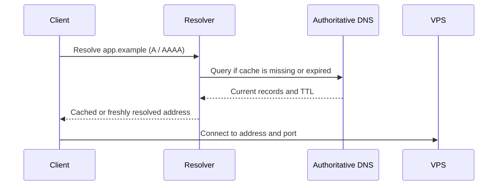

# 02 — DNS records and domain verification

## Learning objectives

You can explain how a hostname becomes an IP address, choose appropriate records for a VPS, verify authoritative and recursive answers, and avoid publishing unreachable endpoints.

## DNS is naming, not reachability

The Domain Name System (DNS) maps names to data. A client asks a recursive resolver for records; the resolver may answer from cache or query the domain's authoritative name servers. The returned address is only a destination hint. Routing, provider policy, the VPS firewall, a listening service, and TLS must still work independently.



## Records used for a VPS

| Record | Purpose | Typical use |
|---|---|---|
| `A` | Maps a name to an IPv4 address | Domain or `app` hostname to the VPS IPv4 address |
| `AAAA` | Maps a name to an IPv6 address | Publish only when IPv6 routing, firewall, and service reachability are configured and tested |
| `CNAME` | Aliases one name to another name | A subdomain alias; the target must itself resolve |
| `NS` | Identifies authoritative name servers | Usually controlled by the registrar or DNS provider |
| `TXT` | Publishes text data | Domain verification and other service-specific purposes |
| `PTR` | Reverse mapping from an address to a name | Usually managed by the IP address provider; often relevant to mail, not ordinary website routing |

The zone apex (for example, `example.com`) has restrictions on a conventional CNAME because it also needs records such as NS and SOA. DNS providers may offer ALIAS/ANAME flattening, but that behavior is provider-specific. For a simple VPS, an A record at the apex and an A/AAAA record for a subdomain are common choices.

An `AAAA` record is not harmless decoration: many clients prefer IPv6 when it is published. If the VPS has no working IPv6 route or the firewall/service is not configured for IPv6, those clients may fail even though IPv4 works. Confirm IPv6 end to end before publishing it. Removing an incorrect record may take time to be reflected everywhere because resolvers honor cached TTLs.

## TTL, caching, and propagation

The time to live (TTL) controls how long a resolver may cache a DNS answer. It is not a guarantee that all resolvers update at the same instant. Before a planned address change, lowering TTL in advance can shorten the period in which some clients use the old address; caches that already hold an earlier answer can still honor its prior TTL.

DNS changes do not usually require a server reboot. Check the record at the authoritative provider and then query through a recursive resolver. A positive cached answer can be stale until its TTL expires; a negative answer can also be cached. Avoid changing records repeatedly while diagnosing one failed connection.

## Verify records without leaking credentials

Use a placeholder for the hostname until substituting your own domain:

```sh
dig +noall +answer app.example.com A
dig +noall +answer app.example.com AAAA
dig +noall +answer app.example.com CNAME
dig +trace app.example.com A
getent ahosts app.example.com
```

`dig` lets you inspect record types and, with `+trace`, follow delegation. `getent` shows how the local system resolves a name through its configured name-service path. A domain may not have every queried type. Use the DNS provider's UI or API to inspect what is actually configured, and compare the result with the intended VPS address from the provider panel.

DNSSEC adds authenticity checks to DNS data when enabled and correctly configured; a broken delegation or signing chain can make a domain fail validation for validating resolvers. Do not enable or modify DNSSEC blindly during an address change—follow the DNS provider's and registrar's documented procedure.

## DNS and HTTPS are separate checks

Once DNS resolves, test the destination service independently. HTTP may redirect to HTTPS, and a TLS certificate must be valid for the hostname the client requested. A certificate for an IP address or a different hostname does not satisfy normal hostname verification. Certificate issuance and reverse-proxy configuration are covered in the later reverse-proxy subject; this course verifies naming and network reachability only.

## Knowledge check

1. Why should you avoid creating an AAAA record before testing IPv6 reachability?
2. What does a TTL govern, and why can a change appear inconsistent?
3. Which part of an HTTPS request is not established just by receiving a correct A record?
4. Who generally controls a VPS address's PTR record?

## Practical checkpoint

Complete [Task 02 — Configure and verify the intended DNS records](../tasks/02-configure-and-verify-dns-records.md).
