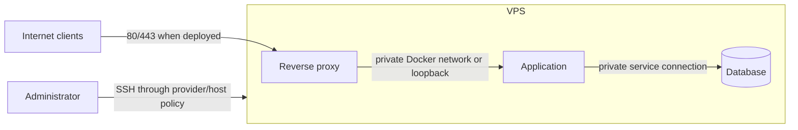

# 05 — Service binding and private container networks

## Learning objectives

You can determine which interfaces a service listens on, distinguish loopback access from public exposure, and plan application/database connectivity without publishing internal ports.

## Binding is an exposure decision

A service can listen on loopback, one specific interface, or all interfaces. That choice determines which network paths can reach its socket before firewall policy is considered:

| Bind address | Intended reachability |
|---|---|
| `127.0.0.1` | Local IPv4 processes only |
| `::1` | Local IPv6 processes only |
| Specific private/interface address | Clients that can route to that interface |
| `0.0.0.0` | All IPv4 interfaces |
| `::` | IPv6 interfaces; verify dual-stack behavior on the host |

Binding to all interfaces does not always mean the service is reachable from the internet: provider and host firewalls may block it. But it enlarges the attack surface if a rule changes, the provider network changes, or another path exists. A firewall rule is not a substitute for choosing the narrowest useful bind address.

Inspect listening sockets and owning processes:

```sh
sudo ss -lntup
```

For a specific port, use `sudo ss -lntp 'sport = :PORT'` (replace `PORT` with a number). Do not assume a port's owner from its number. If an unexpected service is listening publicly, identify its package and configuration before stopping or reconfiguring it.

## Intended topology for a single VPS

A common pattern is to expose only the reverse proxy and keep application/database traffic on private paths:



The database should normally be reachable only by the application and authorized administrative tooling, not by arbitrary internet clients. If a managed external database is used, use its private connectivity or carefully restricted access, TLS, and provider controls; do not assume it is local.

## Docker networking preview

When Docker is introduced, containers on a user-defined network can reach one another by service name without publishing every service port on the VPS. A Compose service `ports` mapping publishes a port on the host. Writing it as `127.0.0.1:HOST_PORT:CONTAINER_PORT` restricts that host-side listener to IPv4 loopback. Omitting `ports` entirely and relying on a shared private network keeps the service un-published on the host's external interfaces.

Compose `expose` documents/advertises a container port to connected containers but does not create an external host port mapping. It is not an access-control boundary between all possible networks. Docker networking details vary by engine, driver, and configuration; verify the actual resulting sockets and external reachability. Published ports can interact with firewall rules in ways that bypass assumptions based on UFW alone.

Do not apply Docker commands or install Docker as part of this subject; Docker operations are covered next. For now, build the intended exposure matrix and inspect any existing listeners. Never launch a database or demonstration web server bound to a public interface just to test networking.

## Local and remote tests answer different questions

`curl http://127.0.0.1:PORT` checks a local loopback path. It does not prove that another machine can connect. A request to the VPS's public address from the same VPS may also be affected by NAT loopback/hairpin behavior and is not a reliable substitute for an external test.

For each service, record:

- The process and reason it must listen.
- The protocol and port.
- The bind address.
- Which clients need access.
- Which provider and host firewall rules permit that access.
- How reachability will be tested from an independent network.

## Knowledge check

1. Why prefer a loopback or private-network bind when only a local proxy needs access?
2. What does a Docker `ports` mapping do that a private container network does not?
3. Why is `expose` not equivalent to a host-published port?
4. Why does a successful `curl` to loopback not prove public reachability?

## Practical checkpoint

Complete [Task 05 — Inventory listeners and define private service paths](../tasks/05-inventory-listeners-and-define-private-service-paths.md).
