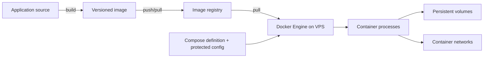

# 01 — Docker’s model: images, containers, and the engine

## Learning objectives

After this lesson, you can explain the difference between an image and a container, identify the role of the Docker Engine and a registry, and describe why Docker access and container boundaries matter to host security.

## The pieces

Docker is a toolset and API for building and running containers. On a typical Linux VPS:

- The **Docker CLI** (`docker`) sends requests to the Docker API.
- The **Docker Engine/daemon** (`dockerd`) manages images, containers, networks, and volumes.
- Lower-level runtime components create and supervise the isolated processes.
- An **image** is a read-only, layered filesystem plus metadata describing how to start a process.
- A **container** is a process created from an image, with a writable runtime layer and configured namespaces, cgroups, mounts, networking, and limits.
- A **registry** stores and distributes images. It may be public or require authentication.
- **Docker Compose** describes and operates a set of related containers as an application.

The CLI and daemon need not be on the same machine. For this course, the VPS daemon is local. Keep its API socket private; exposing an unauthenticated Docker API over TCP can grant remote control of the host.



## Image versus container

Think of an image as a packaged, versioned starting point and a container as one configured execution of it. Running an image creates a container; restarting a stopped container reuses that container's writable layer. Removing and recreating it from the image discards that writable layer. Files that must outlive replacement belong in an explicitly managed volume or a carefully chosen bind mount.

Container IDs and generated names identify runtime instances, not releases. A release should instead be identified by an image tag under your control and, where exact identity matters, by its immutable content digest.

Useful read-only inspection commands:

```sh
docker version
docker info
docker image ls
docker container ls --all
docker network ls
docker volume ls
```

On a fresh machine, some commands may fail until Engine is installed or the current user is authorized to access it. Do not “fix” an authorization error by making the daemon socket world-writable.

## Containers are not small virtual machines

A container is a set of isolated host processes; it shares the host kernel. Namespaces isolate views of resources such as process IDs and networking. Control groups account for and constrain resource use. Mounts provide the container filesystem. These mechanisms are useful isolation, but do not make a container equivalent to a separate kernel or a security boundary against every host-level threat.

Operational consequences:

- A process in a container can still consume host CPU, memory, disk, and network resources.
- A privileged container, a mounted Docker socket, broad host bind mounts, or excessive Linux capabilities can undermine isolation.
- A kernel vulnerability or daemon compromise can affect the host.
- Container filesystem changes are generally disposable; persistent state must be designed explicitly.
- Docker's default bridge/network and port publishing behavior should be verified rather than assumed.

Run only trusted images, keep the host and Engine patched, use least privilege, and avoid `--privileged` unless a reviewed requirement truly calls for it.

## Docker daemon access is privileged

On a conventional rootful installation, the daemon runs with host-level privileges. A user who can control it can usually start a container that mounts and modifies host files. Membership in the `docker` group is therefore effectively root-equivalent access, even though the user's shell prompt does not become root.

Where lesson or task examples omit `sudo`, prefix Docker commands with it on a rootful VPS unless the account has a deliberate, reviewed access design that grants daemon control. For rootless Docker, use its documented access model instead of adding `sudo`. Restrict daemon access, protect SSH credentials, review who can use the VPS, and document revocation. Rootless Docker can reduce some daemon privileges, but has different networking, storage, and operational trade-offs; it is not automatically a drop-in fix.

Never:

- Expose `/var/run/docker.sock` to an application container.
- Make the daemon socket world-readable/writable.
- Publish the daemon API on an unauthenticated network interface.
- Add a CI/deployment account to the Docker group without recognizing the host-root implications.

## Lifecycle vocabulary

Common operations and their scope:

| Operation | Effect |
|---|---|
| `docker pull IMAGE:TAG` | Fetches an image; does not run it. |
| `docker run ... IMAGE:TAG` | Creates and starts a new container from an image. |
| `docker start NAME` | Starts an existing stopped container with its existing configuration. |
| `docker stop NAME` | Requests a graceful stop, then may force termination after a timeout. |
| `docker restart NAME` | Stops and starts the same container; it does not apply new configuration. |
| `docker rm NAME` | Removes a stopped container; its writable layer is lost. |
| `docker compose up -d` | Creates/recreates the services described by Compose as needed. |
| `docker compose down` | Stops and removes the Compose project containers and network; named volumes normally remain unless explicitly removed. |

The exact effect depends on flags and Compose configuration. Inspect a command before running it against a production project, especially options that remove volumes or prune resources.

## Knowledge check

1. Which data survives when a container is removed and recreated from its image?
2. Why is access to a rootful Docker daemon effectively privileged host access?
3. What is the difference between `docker restart` and recreating a service after changing its configuration?
4. Why is a container not equivalent to a virtual machine?

## Practical checkpoint

Complete [Task 01 — Discover and document the application runtime contract](../tasks/01-discover-and-document-the-application-runtime-contract.md).
