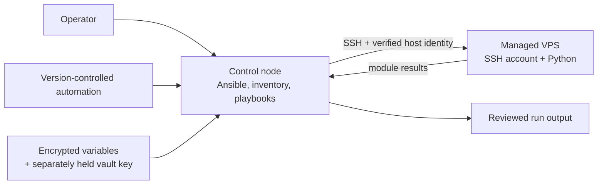

# 01 — Ansible architecture: control nodes and managed hosts

## Learning objectives

After this lesson, you can identify the Ansible control node and managed host, describe the SSH-based execution model, select a supported control environment, and explain what Ansible does—and does not—guarantee about a server.

## The control model

Ansible is a configuration-management and orchestration tool. Its usual Linux-server pattern is agentless: Ansible runs on a **control node**, connects to a **managed host** (the VPS) over SSH, transfers or invokes the required module code, gathers results, and exits. The managed host generally needs a supported Python interpreter for most modules; it does not need a continuously running Ansible agent. Some tasks use raw commands before Python is available, but that is a bootstrap exception, not a replacement for normal modules.

The control node can be a Linux or macOS workstation, a Linux virtual machine, or a Linux environment such as WSL2 on a Windows workstation. Ansible's normal control-node support is Linux/Unix-oriented; do not assume a native Windows shell is a supported controller. Use a maintained Python installation and an isolated environment so the Ansible version and Python packages used by the project are explicit. A CI runner can become a future control node, but this course first establishes a human-operated, inspectable process.

The controller is trusted: it holds access to the inventory, SSH credentials, and any decrypted secrets at run time. Protect it, keep private keys out of the repository, and do not use an unknown shared machine as the controller. A playbook is executable code with the ability to change hosts; reviewing it is a security task, not just a formatting step.

## How a run is selected

Ansible combines several inputs:

- **Configuration** (`ansible.cfg`) controls defaults such as inventory paths, roles paths, and SSH behavior.
- **Inventory** names hosts and groups and may assign connection metadata.
- **Playbooks** define the desired operations and which inventory hosts to target.
- **Variables** supply environment- or host-specific values.
- **Plugins and collections** provide connection, lookup, filter, and module implementations.

The operator chooses a playbook and target pattern, for example a group such as `vps`. A pattern can match more hosts than expected; preview host selection before a production run. Keep configuration project-local where practical so another operator can reproduce the invocation instead of inheriting hidden personal settings.

Ansible does not create a secure baseline merely because it runs successfully. It will faithfully apply mistakes too. It does not automatically provide a rollback transaction, prove that every module supports preview, or guarantee that a fresh VPS has the right firewall, user, DNS, or application settings. Recovery access, explicit desired state, testing, and review remain operational responsibilities.

## Version and platform compatibility

Record the Ansible Core version, Python version, target operating system and release, and required collections. Test the selected versions together. Modules may differ in options across releases, and target modules depend on the target's platform and Python. Pin deliberate dependencies for repeatability; do not copy arbitrary version pins without understanding their support and security-update policy.

Before relying on a playbook, verify:

1. The controller's supported Python and Ansible installation.
2. SSH reachability and verified host keys.
3. The target's OS and release from a trusted source, such as gathered facts.
4. Python availability and interpreter selection.
5. The exact inventory hosts the proposed command will affect.

`ansible.builtin.ping` is an Ansible connectivity/module test, not an ICMP echo request. It proves that Ansible can connect and execute its ping module; it does not prove the application is reachable or healthy.

## Knowledge check

1. Which machine executes the playbook, and which machine is modified?
2. Why should the controller and its private keys be protected?
3. What does an Ansible ping prove, and what does it not prove?
4. Why is a successful playbook run not itself evidence that a server is production-ready?

## Practical checkpoint

Complete [Task 01 — Document the manual baseline and prepare the control node](../tasks/01-document-the-manual-baseline-and-prepare-the-control-node.md).
