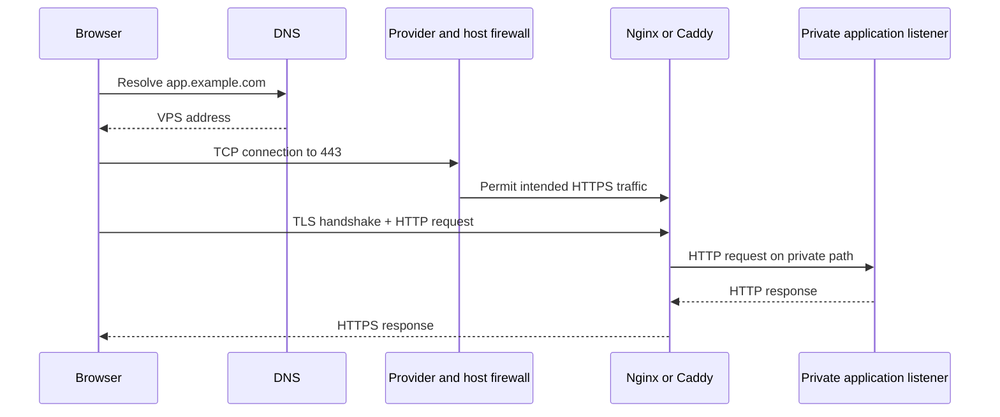

# 01 — The request path, reverse proxies, and trust boundaries

## Learning objectives

You can trace a browser request from DNS through the VPS to the application, explain what a reverse proxy does, distinguish the public entry point from the application listener, and identify which components are allowed to assert request metadata.

## Follow one request

A successful web page load depends on several independent layers. DNS gives a client an address; it does not open a port or prove that the right application is listening. Network routing and provider/host firewalls determine whether the client can reach that address. The proxy accepts the public connection, negotiates TLS, selects a route, and makes a separate connection to the application. The application still has to understand the request and return a valid response.



The reverse proxy is the public-facing server that forwards requests to another server behind it. It can terminate TLS, route by hostname/path, apply connection and request-size limits, and produce access/error logs. It does not make an unsafe upstream safe by itself: the application remains responsible for authentication, authorization, input validation, and correct business behavior.

## Public and private listeners

For a single VPS, the intended public web path is usually:

```text
Internet -> VPS TCP 443 (and often 80 for redirect/ACME) -> reverse proxy
                                                      -> private app port
```

The app should listen on loopback or a private container network, not a public interface. For example, a host-based proxy can reach a container published as `127.0.0.1:8080:8080`; it cannot use that mapping if the proxy is itself in a separate container unless both containers share a network or a deliberate host gateway path is configured. Conversely, publishing `8080:8080` without a loopback address commonly binds on all host interfaces. Check the actual listener and test from another network; do not infer exposure from a Compose file alone.

If Nginx/Caddy and the application are containers, put them on a user-defined Docker network and publish only the proxy's web ports. The application service should have no public `ports` mapping unless there is a specific, reviewed need. If the proxy runs on the host, bind a published upstream port to loopback. Docker's network rules can interact with host firewalls, so external verification remains necessary.

## TLS termination and the trust boundary

In the common TLS-termination design, the browser's encrypted connection ends at the proxy. The proxy then sends HTTP to the app over loopback or a private network. This is a reasonable single-host design when that internal path is trusted and isolated; it is not end-to-end encryption. A multi-host or otherwise untrusted internal network may require TLS between proxy and upstream as well.

Because the app sees the proxy's connection as its direct peer, it may need forwarded metadata such as the original scheme or client address. Those headers are not inherently trustworthy: an internet client can send headers with the same names. The trusted proxy must overwrite or normalize them, and the application must accept proxy metadata only from configured trusted proxy addresses. A direct route to the app can let a client bypass those controls.

For a simple single proxy, set the forwarded client address from the connection peer rather than preserving a client-supplied `X-Forwarded-For` chain. If a CDN or load balancer is in front, configure its documented address ranges as trusted at the proxy, then derive the client address using the proxy's real-client-IP mechanism. Never trust arbitrary Internet-supplied forwarding headers or use them as an authorization control.

## One hostname, one public contract

Decide which hostnames are served (for example, apex and `www` or only `app.example.com`), whether HTTP redirects to HTTPS, and which paths route to the application. Unmatched hostnames should not accidentally reach the application. A default server/site should reject or safely close unknown hostnames rather than act as an unplanned catch-all.

## Knowledge check

1. Why does successful DNS resolution not prove that HTTPS works?
2. What separate connection does a reverse proxy create?
3. Why can an application not blindly trust an incoming `X-Forwarded-For` header?
4. What is the exposure difference between a loopback-bound container port and a port bound on all interfaces?

## Practical checkpoint

Draw the actual request path for the target VPS. Label every public port, proxy process/container, upstream address, TLS termination point, and trusted-header boundary. Continue with [Task 01 — Define the application-serving contract and traffic design](../tasks/01-define-the-application-serving-contract-and-traffic-design.md).

## References

- [NGINX: Using nginx as a HTTP load balancer / reverse proxy](https://docs.nginx.com/nginx/admin-guide/web-server/reverse-proxy/)
- [Caddy: Reverse proxy](https://caddyserver.com/docs/caddyfile/directives/reverse_proxy)
- [MDN: X-Forwarded-For](https://developer.mozilla.org/en-US/docs/Web/HTTP/Headers/X-Forwarded-For)
